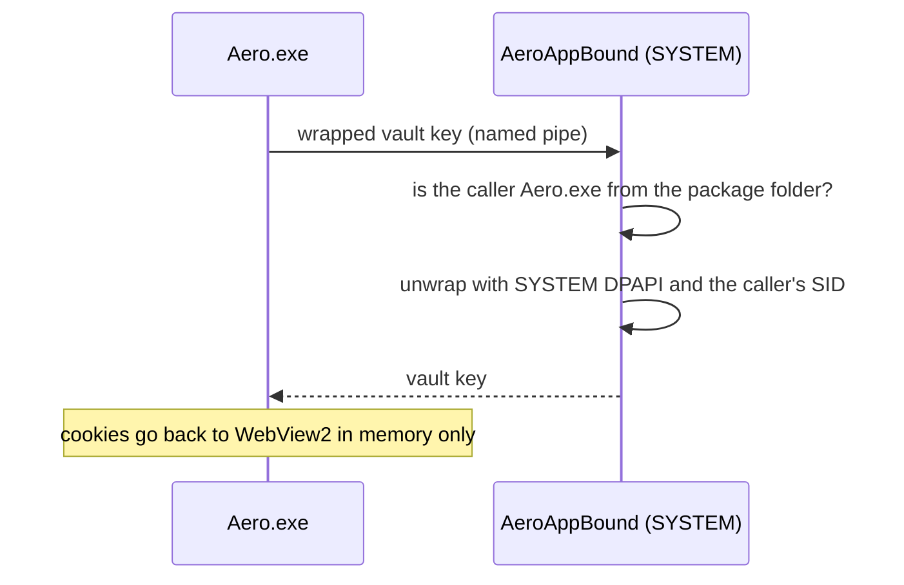

<p align="center">
  
</p>

<h1 align="center">Aero</h1>

<p align="center">
  A fast, quiet Windows browser that assumes info-stealers exist.
</p>

<p align="center">
  
  
  
  
  
</p>

> **Pre-alpha.** Aero is not ready for daily browsing or for accounts you cannot afford to lose. It has not been independently audited.

## Why Aero

- **Instant and quiet.** No news feed, ads, account requirement or telemetry. Background tabs sleep, resource use is visible per tab, and sessions restore lazily.
- **You stay in control.** Per-site permissions, built-in Shield blocker, workspaces, tab groups, split view, containers and private windows.
- **Built against session theft.** Most account takeovers today don't need your password: a stealer copies the browser's cookies and replays your sessions. Aero is designed so that the usual way of doing that stops working.

## Protection against info-stealers

Info-stealers (Lumma, RedLine, Vidar, StealC and their forks) run as the signed-in user and go for the same few things. Here is how a default install of each browser holds up against them.

| Stealer technique | Firefox¹ | Chromium-based app² | Chrome 127+ | **Aero** |
|---|:---:|:---:|:---:|:---:|
| Copy the cookie database and decrypt it as the user | ❌ | ❌ | ✅ | ✅ |
| Copy saved passwords and decrypt them as the user | ❌ | ❌ | ⚠️³ | ✅ |
| Relaunch the browser with a debugging port and dump every cookie | — | ❌ | ✅⁴ | ✅ |
| Read the browser's memory or inject code into it | ❌ | ❌ | ❌⁵ | ⚠️ |
| Malware running as Administrator or SYSTEM | ❌ | ❌ | ❌ | ❌ |

✅ blocked by default · ⚠️ partly blocked · ❌ not blocked · — not a practical vector

<sub>¹ Default profile without a Primary Password: `cookies.sqlite` is plain text and `logins.json` decrypts with `key4.db` offline.<br>
² A Chromium browser or WebView2 app that relies on DPAPI alone: any process of the user can decrypt the key in `Local State`.<br>
³ Chrome began its app-bound encryption rollout with cookies; how far it covers passwords depends on the version.<br>
⁴ Since Chrome 136 the debugging switches are ignored for the default profile.<br>
⁵ Code injection into Chrome is the publicly documented way around its app-bound encryption.<br>
Based on publicly documented defaults; other browsers change between releases, so check current versions before relying on this table.</sub>

### How Aero does it

| Layer | What it does |
|---|---|
| **Cookie vault** | Persistent cookies never stay in WebView2's on-disk Cookies database. Aero turns them into in-memory session cookies and keeps the real copy in an AES-256-GCM vault. |
| **App-bound key** | The vault key is wrapped by `AeroAppBound`, a tiny LocalSystem service shipped in the MSIX. It unwraps the key only for `Aero.exe` from its own package folder. A stealer can copy the files but cannot open them. |
| **Windows Hello (opt-in)** | Settings → *Protect site sign-ins with Windows Hello* additionally requires your face, fingerprint or PIN on every launch. |
| **Password vault** | Saved passwords are encrypted with a non-exportable Windows Hello key and revealed only in a separate, hardened broker process. WebView2's own password store is turned off. |
| **Launch guard** | Environment variables and registry policies that would start WebView2 with a debugging port, another runtime or another profile are removed or refused before the engine starts. |
| **Process guard** | Other processes of the user cannot open `Aero.exe` to read or write its memory or start threads in it, and cannot reset that rule without admin rights. Remote DLL loads and legacy injection points are blocked. |



The service starts on demand and exits after a minute idle: about 60 ms on a cold start (in parallel with WebView2 startup), 1 ms when warm, 8.5 MB while running, nothing between launches.

### What Aero does not protect against yet

- **Injection into a running Aero.** Like Chrome's app-bound encryption, this layer stops file theft, not code that is already inside the browser.
- **WebView2's own processes.** While Aero runs, cookies live in memory in the WebView2 network process, which other processes of the user can still read. Chromium crashes if those processes are locked down from user mode.
- **Administrator-level malware.** Nothing in user mode survives it. The optional kernel driver (`Aero.Security.Driver`) currently protects only the password broker.
- **Development builds.** Without the MSIX there is no key service, so the cookie vault stays off unless Windows Hello protection is turned on.

Found a weakness? See [SECURITY.md](SECURITY.md).

## Build

1. Install Visual Studio 2026 with the Windows application development workload and the Windows App SDK / WinUI tools.
2. Install the .NET 10 SDK.
3. Open `Aero.sln`, select `x64` and run `Aero.App`.

```powershell
dotnet build Aero.sln -c Debug -p:Platform=x64
```

Smoke tests are console projects: `dotnet run --project tests/<name> -p:Platform=x64`. The signed MSIX and installer are built with `BUILD_AERO_MSIX.cmd` and `BUILD_AERO_INSTALLER.cmd`.

## Repository map

```text
src/Aero.App                Windows UI and WebView2 host
src/Aero.Core               Browser-independent domain logic
src/Aero.WebView            WebView2 environment, launch guard, controller lifecycle
src/Aero.Navigation         Navigation identity, timing and completion policy
src/Aero.Search             Address bar resolution and suggestions
src/Aero.Shield             Native request blocker
src/Aero.Storage            Atomic settings, history, bookmarks and sessions
src/Aero.Downloads          Download naming, paths and deduplication
src/Aero.Extensions         Extension catalog and permission risk
src/Aero.Security           Vaults, process guard, app-bound key client
src/Aero.Security.Broker    Hardened process that reveals passwords
src/Aero.Security.AppBound  LocalSystem key service for the cookie vault
src/Aero.Security.Driver    Optional kernel driver for the broker
src/Aero.Installer          WinUI installer
.github/brand               Logo sources (SVG)
tests/                      Smoke-test console projects
```

## License

Copyright (c) 2026 finchproffe. Aero is licensed under the [Mozilla Public License 2.0](LICENSE). The Microsoft WebView2 Runtime is a separate Microsoft dependency; see [NOTICE.md](NOTICE.md). The Aero name and logo are not covered by the code license.
