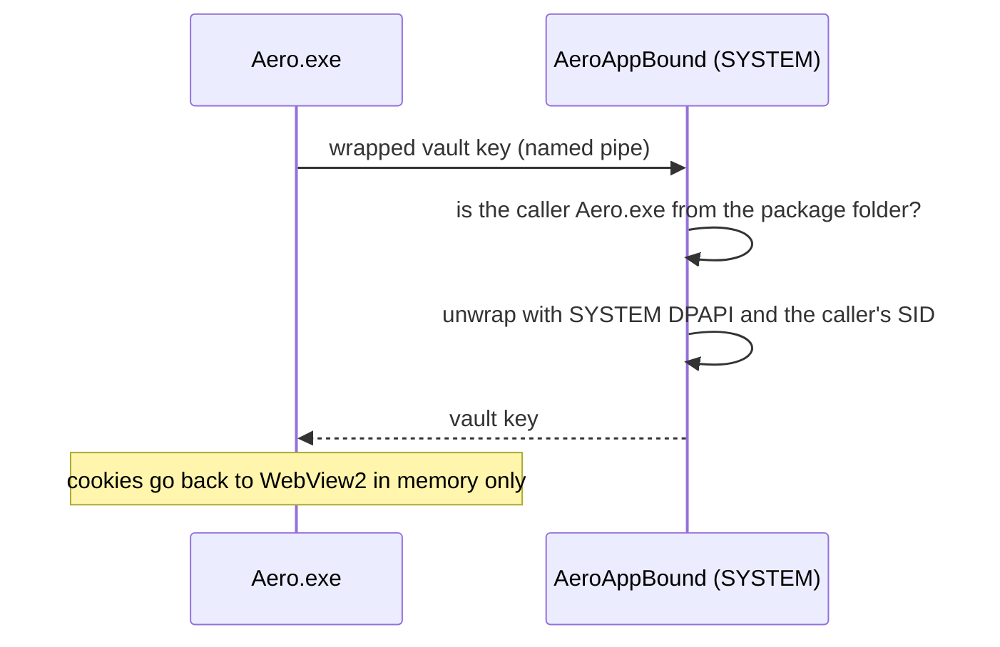
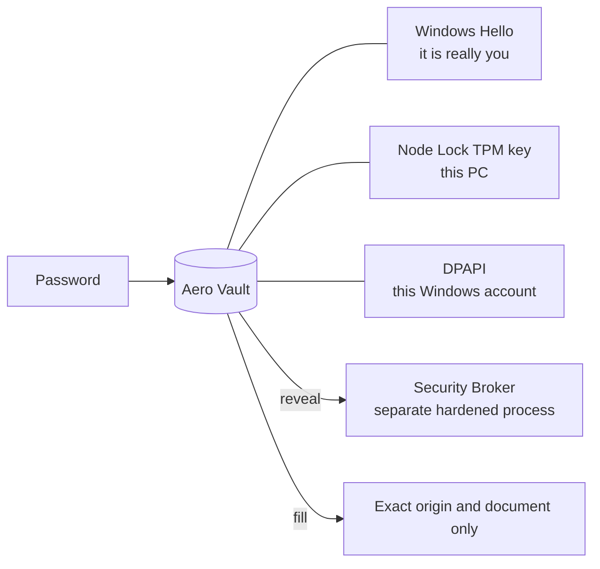

<p align="center">
  
</p>

<h1 align="center">Aero</h1>

<p align="center">
  A fast, quiet Windows browser that assumes info-stealers exist.
</p>

<p align="center">
  
  
  
  
  
</p>

> **Pre-alpha.** Aero is not ready for daily browsing or for accounts you cannot afford to lose. It has not been independently audited.

## Why Aero

- **Instant and quiet.** No news feed, ads, account requirement or telemetry. Background tabs sleep, resource use is visible per tab, and sessions restore lazily.
- **You stay in control.** Per-site permissions, built-in Shield blocker, workspaces, tab groups, split view, containers and private windows.
- **Moving in is easy.** Import from Chrome, Edge, Yandex Browser, Brave, Vivaldi, Opera and Firefox. Only the tabs that are open in the other browser come over (the current page of each, at most 50), not its history. DRM video (Widevine, PlayReady), passkeys and one-click page translation work out of the box.
- **A home page that is yours.** A large clock over a sky that follows the time of day, quick links, the sites you were on with their icons, bookmarks, workspaces and what Aero blocked in this window. Hidden in private and guest windows.
- **Free sync, no account.** Bookmarks and passwords travel between your PCs through a cloud folder you already have. See [Sync without a server](#sync-without-a-server).
- **Built against session theft.** Most account takeovers today don't need your password: a stealer copies the browser's cookies and replays your sessions. Aero is designed so that the usual way of doing that stops working.

## Protection against info-stealers

Info-stealers (Lumma, RedLine, Vidar, StealC and their forks) run as the signed-in user and go for the same few things. Here is how a default install of each browser holds up against them.

| Stealer technique | Firefox¹ | Chromium-based app² | Chrome 127+ | **Aero** |
|---|:---:|:---:|:---:|:---:|
| Copy the cookie database and decrypt it as the user | ❌ | ❌ | ✅ | ✅ |
| Copy saved passwords and decrypt them as the user | ❌ | ❌ | ⚠️³ | ✅ |
| Relaunch the browser with a debugging port and dump every cookie | — | ❌ | ✅⁴ | ✅ |
| Read the browser's memory or inject code into it | ❌ | ❌ | ❌⁵ | ✅⁶ |
| Read a shown password through UI Automation or a screenshot | ❌ | ❌ | ❌ | ✅ |
| Malware running as Administrator or SYSTEM | ❌ | ❌ | ❌ | ❌ |

✅ blocked by default · ⚠️ partly blocked · ❌ not blocked · — not a practical vector

<sub>¹ Default profile without a Primary Password: `cookies.sqlite` is plain text and `logins.json` decrypts with `key4.db` offline.<br>
² A Chromium browser or WebView2 app that relies on DPAPI alone: any process of the user can decrypt the key in `Local State`.<br>
³ Chrome began its app-bound encryption rollout with cookies; how far it covers passwords depends on the version.<br>
⁴ Since Chrome 136 the debugging switches are ignored for the default profile.<br>
⁵ Code injection into Chrome is the publicly documented way around its app-bound encryption.<br>
⁶ For `Aero.exe` and every WebView2 process: memory reads, dumps, injection, debugging and handle theft are refused. A stealer that launches a fresh Aero itself gets that new process, see [below](#what-aero-does-not-protect-against-yet).<br>
Based on publicly documented defaults; other browsers change between releases, so check current versions before relying on this table.</sub>

### How Aero does it

| Layer | What it does |
|---|---|
| **Cookie vault** | Persistent cookies never stay in WebView2's on-disk Cookies database. Aero turns them into in-memory session cookies and keeps the real copy in an AES-256-GCM vault. The vault key lives encrypted in memory (`CryptProtectMemory`) and is decrypted only for the moment it is used. |
| **App-bound key** | The vault key is wrapped by `AeroAppBound`, a tiny LocalSystem service shipped in the MSIX. It unwraps the key only for `Aero.exe` from its own package folder. A stealer can copy the files but cannot open them. |
| **Windows Hello (opt-in)** | Settings → *Protect site sign-ins with Windows Hello* additionally requires your face, fingerprint or PIN on every launch. |
| **Aero Vault** | Saved passwords sit behind Windows Hello, this PC's TPM and your Windows account at once. See [Aero Vault](#aero-vault) below. |
| **Launch guard** | Environment variables and registry policies that would start WebView2 with a debugging port, another runtime or another profile are removed or refused before the engine starts. |
| **Process guard** | Other processes of the user cannot open `Aero.exe` or any of its WebView2 processes (including the crash handler) to read or write memory, dump them, start threads, attach a debugger or steal their handles, and cannot reset that rule without admin rights. Remote DLL loads and legacy injection points are blocked. |
| **Rust security core** | Protected memory, vault encryption and the process guard live in `aero_security_native.dll` (`src/Aero.Security.Native`). Secrets never touch the .NET heap: they sit in locked pages between no-access guard pages, are excluded from crash dumps and are wiped on release. |



The service starts on demand and exits after a minute idle: about 60 ms on a cold start (in parallel with WebView2 startup), 1 ms when warm, 8.5 MB while running, nothing between launches.

## Aero Vault

<p align="center"><b>Your passwords, locked three times over and never left open.</b></p>

Aero Vault is Aero's own password manager. It does not use the Chromium password store that stealers know how to read, and it is built so that a copied vault file or a screen recorder gets nothing, and a stealer on the PC cannot open the vault without you.

|   | |
|---|---|
| 🔐 **Three keys, all required** | The vault key opens only with your **Windows Hello** (face, fingerprint or PIN, held by a non-exportable key), only on **this PC** (Node Lock: a key kept in the TPM by the Microsoft Platform Crypto Provider) and only for **your Windows account** (DPAPI). A vault file copied to another machine is noise. |
| ⏱️ **Never left unlocked** | There is no "unlocked for 15 minutes" state. Every fill or reveal gets its own short-lived key lease that is destroyed right after. Secrets live in locked memory owned by the Rust core, fenced by guard pages and zeroed before release. |
| 🪟 **Reveal outside the browser** | *Show password* runs in a separate one-shot process, the Aero Security Broker: an HMAC-SHA256-authenticated channel, a hardened process with loader monitoring, and a password window hidden from screen capture and from UI Automation, with text that cannot be copied. The browser process never sees the revealed password. |
| 🎯 **Fills only where it belongs** | Autofill reaches the page through a WebView2 shared buffer bound to the exact origin and document. Aero Vault refuses to fill on IP addresses, local hosts, punycode look-alike domains and suspiciously complex domain names. |
| 🧱 **One store, no duplicates** | WebView2's built-in password saving is off, so there is no second copy in the `Login Data` file that stealers grab. The optional kernel driver can additionally shield the broker. |



### Attribution: Vault is Powered by Aero

Every source file of Aero Vault starts with the notice **"Vault is Powered by Aero"**. Forks and derivative works must keep it: MPL-2.0 section 3.4 forbids removing or altering notices in the source code. If your product ships Aero Vault or code derived from it, credit it in your product and documentation as **Vault is Powered by Aero**.

### What Aero does not protect against yet

- **A stealer that starts Aero itself.** Whoever creates a process gets full access to it, so malware can launch its own Aero and inject into it. Like Chrome's app-bound encryption, Aero stops file theft and attacks on the Aero you are running, not code that becomes part of a new Aero.
- **Handle theft from Aero.exe.** WebView2 hands shared buffers to `Aero.exe` by duplicating handles into it, so `Aero.exe` cannot refuse `DUP_HANDLE`. A stealer that knows that trick can still reach its memory. WebView2's own processes refuse it.
- **Administrator-level malware.** Nothing in user mode survives it. The optional kernel driver (`Aero.Security.Driver`) currently protects only the password broker.
- **Development builds.** Without the MSIX there is no key service, so the cookie vault stays off unless Windows Hello protection is turned on.

Found a weakness? See [SECURITY.md](SECURITY.md).

## Sync without a server

Aero has no sync server and no account. Pick a folder that your own cloud client already syncs (OneDrive comes with Windows; Yandex Disk, Google Drive, Dropbox and Syncthing work too) and choose a sync passphrase.

| | |
|---|---|
| 🔑 **End-to-end encrypted** | Everything in the folder is AES-256-GCM encrypted with keys derived from your passphrase (PBKDF2-SHA256, 600,000 rounds). Neither the cloud nor the Aero project can read it. |
| 📚 **Bookmarks** | Sync on their own every couple of minutes, deletions included. |
| 🔐 **Passwords** | Sync on request (*Settings → Import and backups → Sync passwords*), confirmed with the passphrase and Windows Hello. The password key is never stored on the PC, so Aero Vault keeps its "never left unlocked" promise. |
| 💻 **New PC recovery** | Point a fresh install at the same folder and passphrase, sync passwords, and your vault comes back. A PC with an empty vault refills itself and never wipes the others. |
| ☁️ **No conflicts** | Each PC writes only its own file and reads the others', so the cloud never sees two writers on one file. |

Not synced yet: history, open tabs and bookmark order. There is no phone app.

## Stealer simulation

`tests/Aero.Security.Broker.SmokeTests` plays an info-stealer running as you, using the default methods real stealers use, but only against Aero components with canary data it plants itself, in temporary profiles and processes it starts. Nothing is decrypted for real or sent anywhere. Each attack first runs against an unprotected control, so a pass cannot come from a probe that does not work.

| Attack | Result |
|---|---|
| Open Aero for memory reads, `MiniDumpWriteDump`, injection, suspend, debugger | refused |
| Scan process memory for the cookie vault key | not found: concealed |
| Copy the cookie and password vault files, grep them, unprotect them with the user's DPAPI | nothing readable |
| Ask the `AeroAppBound` service to unwrap a stolen cookie key | refused: not `Aero.exe` |
| Scrape cookies from WebView2 memory; open WebView2 and the crash handler for reads, injection or handle theft | cookie found in the unprotected control; refused under Aero's guard, while browsing, scripts, cookies and shared buffers keep working |
| Copy WebView2's `Cookies` database | vaulted cookies are not on disk |
| Reveal a saved password through the Security Broker with a simulated Windows Hello | shown to the user after approval, refused after cancel |
| Read the Broker's password window through UI Automation; screenshot it | not exposed; excluded from capture |

```powershell
dotnet run --project tests/Aero.Security.Broker.SmokeTests -p:Platform=x64
```

The simulated Windows Hello is a test-only class the vault accepts through an internal constructor; Aero itself never creates one, and it never touches the TPM.

## Build

1. Install Visual Studio 2026 with the Windows application development workload and the Windows App SDK / WinUI tools (plus the ARM64 C++ build tools for ARM64 builds).
2. Install the .NET 10 SDK and [Rust](https://rustup.rs). `Aero.Security` builds its native core with `cargo`; for ARM64 also run `rustup target add aarch64-pc-windows-msvc`.
3. Open `Aero.sln`, select `x64` and run `Aero.App`.

```powershell
dotnet build Aero.sln -c Debug -p:Platform=x64
```

Smoke tests are console projects: `dotnet run --project tests/<name> -p:Platform=x64`. The Rust core has its own tests: `cargo test` in `src/Aero.Security.Native`. The signed MSIX and installer are built with `BUILD_AERO_MSIX.cmd` and `BUILD_AERO_INSTALLER.cmd`.

## Repository map

```text
src/Aero.App                Windows UI and WebView2 host
src/Aero.Core               Browser-independent domain logic
src/Aero.WebView            WebView2 environment, launch guard, controller lifecycle
src/Aero.Navigation         Navigation identity, timing and completion policy
src/Aero.Search             Address bar resolution and suggestions
src/Aero.Shield             Native request blocker
src/Aero.Storage            Atomic settings, history, bookmarks and sessions
src/Aero.Downloads          Download naming, paths and deduplication
src/Aero.Extensions         Extension catalog and permission risk
src/Aero.Security           Vaults, process guard, app-bound key client
src/Aero.Security.Native    Rust core: protected memory, vault encryption, process guard
src/Aero.Security.Broker    Hardened process that reveals passwords
src/Aero.Security.AppBound  LocalSystem key service for the cookie vault
src/Aero.Security.Driver    Optional kernel driver for the broker
src/Aero.Installer          WinUI installer
.github/brand               Logo sources (SVG)
tests/                      Smoke-test console projects
```

## License

Copyright (c) 2026 finchproffe. Aero is licensed under the [Mozilla Public License 2.0](LICENSE). The Microsoft WebView2 Runtime is a separate Microsoft dependency; see [NOTICE.md](NOTICE.md). The Aero name and logo are not covered by the code license.
